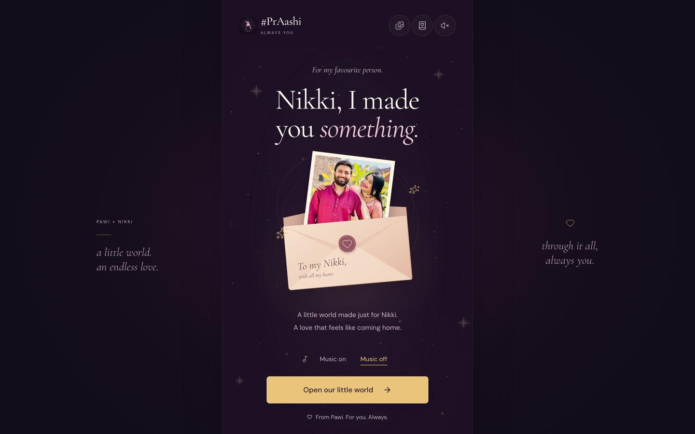
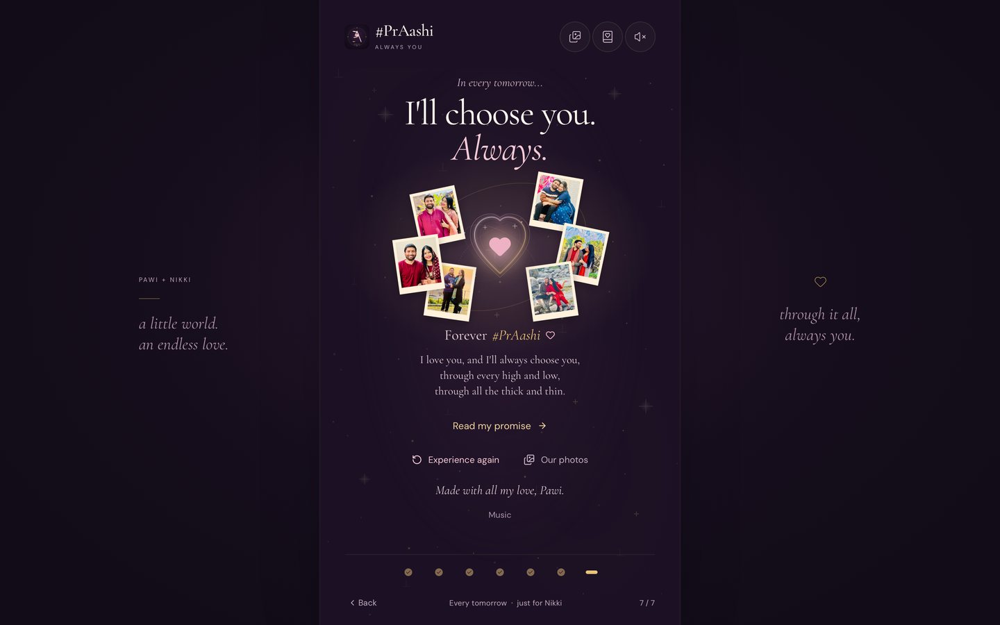
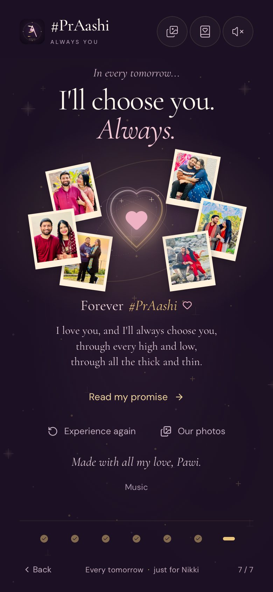
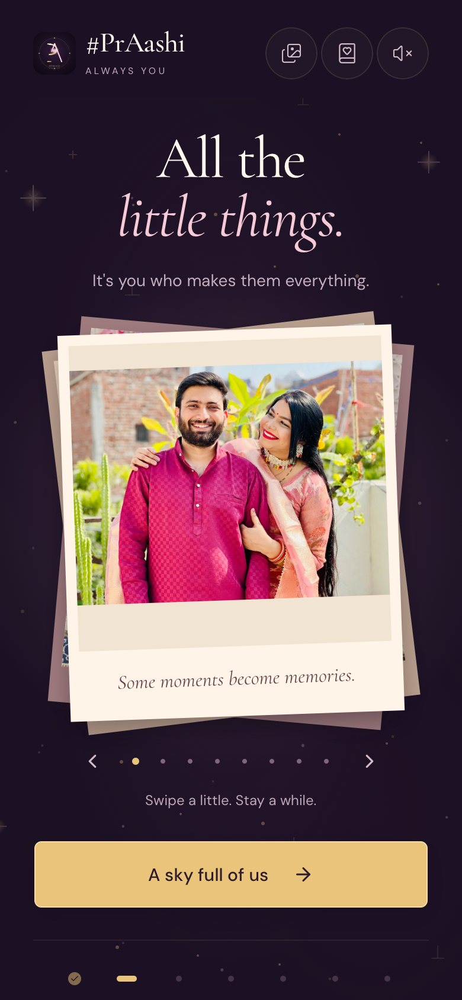
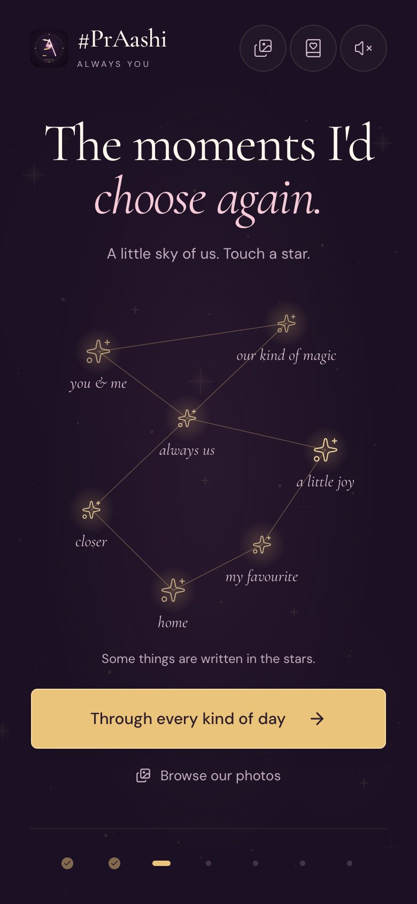
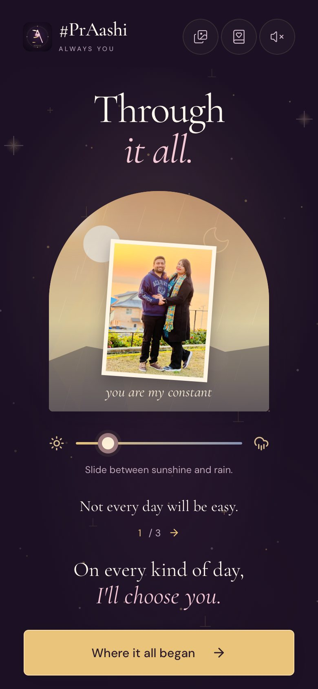
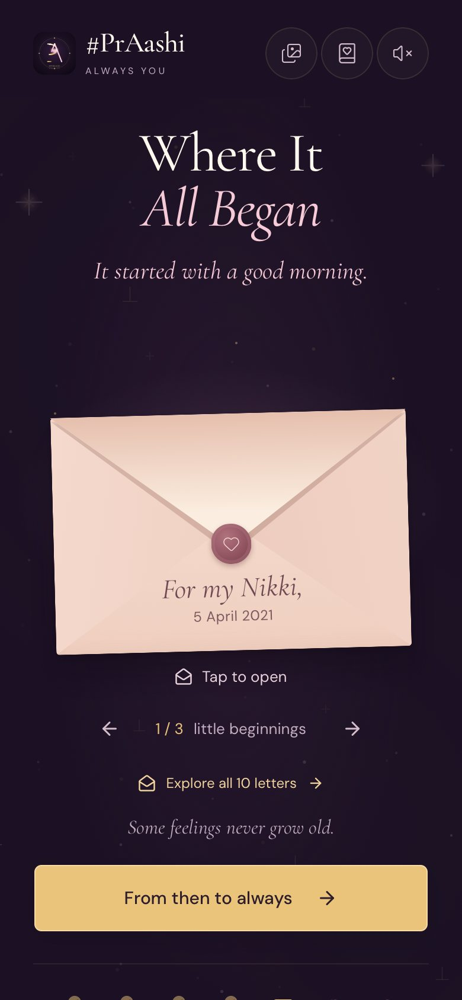
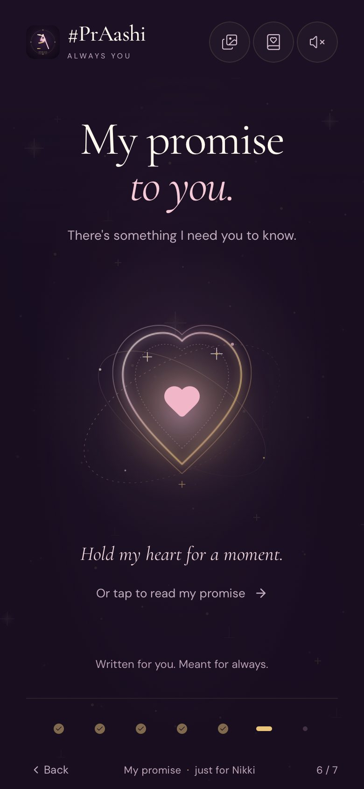

# #PrAashi — Always You 💌

> A cinematic, mobile-first love letter in seven chapters. The final surprise of a real-world treasure hunt, opened by scanning a QR code.

**Live:** [praashi-custom.vercel.app](https://praashi-custom.vercel.app)

<p align="center">
  
  
  
</p>

<p align="center">
  
  
  
  
  
</p>

Made by Pawi for his wife, Nikki. It has one recipient and one occasion: a treasure hunt of handwritten notes and gifts that ends at an iPad showing a QR code. She scans it with her iPhone and this opens.

## The seven chapters

| | Chapter | What happens |
|---|---|---|
| 1 | **Nikki, I made you something.** | A photograph tucked in an envelope, and an optional choice of music |
| 2 | **All the little things.** | A swipeable stack of Polaroids |
| 3 | **The moments I'd choose again.** | Touch each star in a constellation to reveal a photograph |
| 4 | **Through it all.** | Slide between sunshine and rain |
| 5 | **Where It All Began.** | Open real love letters from 2021, sealed in envelopes |
| 6 | **My promise to you.** | Hold a heart for two seconds to open the final letter |
| 7 | **Every tomorrow.** | "I'll choose you. Always." |

## Highlights

- **A guided first run:** later chapters and shortcuts unlock as she goes, and each next button waits until everything in its chapter has been seen. One complete run unlocks everything for good.
- **A paper envelope with no image assets:** layered CSS with a real flap, wax seal and rising note, opening in about a second. Reduced motion opens it instantly.
- **Authentic letters:** dated excerpts sit beside the unmodified original screenshots, and each file is checked against its recorded hash.
- **One continuous soundtrack:** music never plays until she chooses it. Volume follows the story through Web Audio, quieter for the letters and fuller at the ending.
- **Light that carries the emotion:** low-opacity gradients, scene by scene, warming toward the ending without touching the photographs.
- **Built for iPhone Safari:** safe areas, a layout that stays stable as the toolbar collapses, 44px touch targets and pinch zoom.
- **Reliable on the day:** a service worker keeps the story available offline once loaded, while new deployments reach returning visitors on their next load.
- **No tracking:** no accounts, backend, analytics or third-party requests at runtime. Progress stays in `localStorage`.
- **Accessible:** keyboard support, screen reader labels, reduced motion and a tap alternative to every gesture.

## Built with

React · TypeScript · Vite · Tailwind CSS · Motion · Playwright

## Run locally

```bash
npm install
npm run dev
```

## Checks

```bash
npm run lint
npm run typecheck
npm run build
npx playwright install chromium webkit
npm test
```

The Playwright suite runs in Chromium and WebKit, and tests the built app, so run `npm run build` first. WebKit automation is not the same as a physical iPhone, so real-device checks remain a separate step.

## Project notes

- [PRODUCT.md](PRODUCT.md) and [DESIGN.md](DESIGN.md): purpose and design system
- [docs/notes/](docs/notes/): creative direction, QA history and deployment notes

## License

Code is released under the [MIT License](LICENSE). Photos, letters, artwork, audio and written content are not covered by it: personal media is © Prawal Sharma, all rights reserved, and third-party assets remain under their own licenses.

Music: [Echoes of Embrace](https://freemusicarchive.org/music/maarten-schellekens/soft-piano-music/echoes-of-embrace/) and [Pristine Reverie](https://freemusicarchive.org/music/maarten-schellekens/soft-piano-music/pristine-reverie/) by Maarten Schellekens, [CC BY-NC 4.0](https://creativecommons.org/licenses/by-nc/4.0/), joined and faded for this project. Full terms: [assets/licenses/MUSIC.md](assets/licenses/MUSIC.md).
